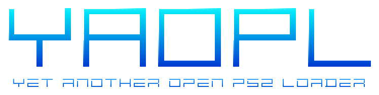

  

  
  
  

YAOPL (Yet Another Open PS2 Loader) is a game and application loader for the PlayStation 2 and
backward-compatible PS3 models. It continues the development of [Open PS2 Loader](https://github.com/ps2homebrew/Open-PS2-Loader)
(OPL): it runs the same games from the same devices, keeps OPL's folders, settings and file name, and adds
its own fixes and new devices.

## Why YAOPL

- **Stability first.** Many fixes in YAOPL are for crashes, hangs, memory corruption and lost settings that
  OPL hits on unusual or malformed files: cheat files, ISO and ZSO images, `SYSTEM.CNF`, `ul.cfg`,
  `games.bin`, themes, configuration files and VMCs.
- **Every fix is shown, not assumed.** A bug is reproduced on upstream OPL first, with a host program in
  [`labs/host-repro`](labs/host-repro/README.md) or a console test, and the same check shows it gone. The
  changelog says so when a fix is not yet confirmed on a console.
- **A drop-in replacement.** Games, `CFG`, `VMC`, `ART`, themes and translations made for OPL work as they are,
  and the ELF is still `OPNPS2LD.ELF`, so launcher entries keep working.
- **Close to upstream.** Changes stay small and are merged with upstream's, so that OPL's own progress
  reaches YAOPL too. Fixes from other forks are taken only after they are checked against upstream's code.
- **Reproducible builds.** Every build uses a pinned toolchain image, so the same commit always embeds the
  same SDK modules, and the release notes name the ps2sdk commit.

## Features

- Games from **USB** drives, **MX4SIO** SD adapters, **iLink** drives, expansion-port **HDDs** (APA, or GPT/MBR
  with exFAT), **SMB** shares and, new in YAOPL:
  - **UDPBD**: a disk or disk image that a PC serves over the LAN, with all of YAOPL's features;
  - **MMCE**: memory-card emulators with an SD card (SD2PSX, MemCard PRO 2, PSXMemCard Gen2), which also get the
    game ID and switch to the game's own memory card.
- ISO, ZSO (compressed ISO) and USBExtreme images; homebrew apps.
- Per-game compatibility modes, virtual memory cards (VMC), the PS2RD cheat engine, GSM video modes, pad
  emulation for DualShock 3 and 4, in-game reset, an NBD server for the HDD, themes and translations.

## Download

Every change to `master` is built and published as the [`latest` release](https://github.com/belomaxorka/yaopl/releases/tag/latest):
`OPNPS2LD.ELF`, the 7z packages and `SHA256SUMS`. YAOPL versions end in `-yaopl`, for example
`v1.2.0-Beta-2310-1a2b3c4-yaopl` (START → About), so they are easy to tell apart from official OPL builds.

## Documentation

- [User guide](https://github.com/belomaxorka/yaopl/blob/master/docs/USAGE.md): installing, folders, devices, formats, apps, cheats, NBD, frequent issues.
- [Changelog](CHANGELOG.md): what changed in each build, and what YAOPL changed compared with OPL.
- [Contributing](CONTRIBUTING.md): how changes are made, checked and released, and how upstream is merged.
- [Issues](https://github.com/belomaxorka/yaopl/issues): bug reports and feature requests for YAOPL builds.
  Problems with official OPL builds belong to [upstream](https://github.com/ps2homebrew/Open-PS2-Loader/issues).

## Credits and license

YAOPL is built on Open PS2 Loader: copyright 2009, Ifcaro & jimmikaelkael, and the OPL contributors (see
[CREDITS](CREDITS)). The logo is drawn after OPL's logo by Berion. Some fixes are ported from
[RiptOPL](https://github.com/NathanNeurotic/Open-PS2-Loader) by NathanNeurotic, and the UDPBD and MMCE modules
come from [neutrino](https://github.com/rickgaiser/neutrino) and [ps2-mmce](https://github.com/ps2-mmce/mmceman);
each commit names its source.

YAOPL is licensed under the Academic Free License version 3.0, like OPL; see [LICENSE](LICENSE). It is not an
official OPL build and is not affiliated with the OPL project.
